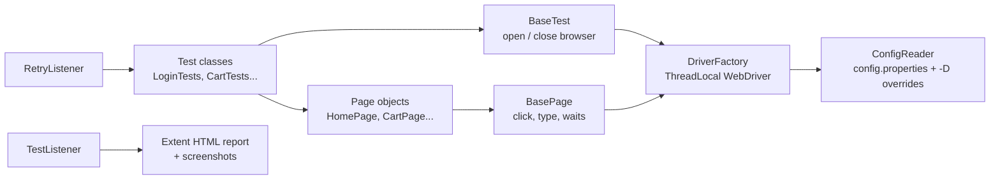

# Toolshop UI Automation Framework

[](https://github.com/Ankita-Sharma-QA/toolshop-selenium-pom/actions/workflows/smoke-tests.yml)
[](https://github.com/Ankita-Sharma-QA/toolshop-selenium-pom/actions/workflows/regression-tests.yml)

A Selenium + TestNG test automation framework built with the **Page Object Model**, testing the
[Practice Software Testing – Toolshop](https://practicesoftwaretesting.com) e-commerce demo site.

It covers the main user journeys of an online shop: login, product search, sorting, filtering,
product details, cart and a full end-to-end checkout. Tests run automatically in **GitHub Actions**:
a smoke suite on every push and a full regression suite every night in Chrome and Firefox.
In CI, the application itself is started in **Docker**, so every run gets a fresh, known database.

## Tech stack

| Tool | Purpose |
|---|---|
| Java 17 | Language |
| Selenium WebDriver 4 | Browser automation (drivers are downloaded automatically by Selenium Manager) |
| TestNG | Test runner, groups, parallel runs, listeners |
| Maven | Build and dependency management |
| Extent Reports | HTML test report with screenshots of failures |
| GitHub Actions | CI pipeline (smoke on push, nightly regression, browser matrix) |
| Docker Compose | Runs the application under test inside the CI pipeline |

## Framework design



**How a test flows:** `BaseTest` opens a fresh browser → the test calls page object methods
(e.g. `homePage.searchFor("Pliers")`) → page objects use `BasePage` helpers that always wait for the
element first → `TestListener` records the result in the HTML report and attaches a screenshot if it fails.

## Project structure

```
src/main/java/com/toolshop/
├── base/BasePage.java            # common actions: click, type, getText, waits
├── pages/                        # one class per page
│   ├── HeaderSection.java        # top navigation bar (shared by all pages)
│   ├── HomePage.java             # search, sort, category filter, product list
│   ├── LoginPage.java
│   ├── AccountPage.java
│   ├── ProductPage.java
│   ├── CartPage.java
│   └── CheckoutPage.java         # sign-in step, billing address, payment
├── utils/
│   ├── ConfigReader.java         # reads config.properties, command line wins
│   ├── DriverFactory.java        # creates Chrome / Firefox / Edge, ThreadLocal for parallel runs
│   └── ScreenshotUtil.java
├── reports/ExtentManager.java    # Extent HTML report setup
└── listeners/
    ├── TestListener.java         # pass/fail/skip in report + screenshot on failure
    ├── RetryAnalyzer.java        # re-runs a failed test once
    └── RetryListener.java        # attaches RetryAnalyzer to every test

src/main/resources/config.properties   # URL, browser, headless, wait time, test user

src/test/java/com/toolshop/
├── base/BaseTest.java            # browser setup/teardown, login helper
├── data/TestData.java            # test data in one place
└── tests/
    ├── LoginTests.java
    ├── SearchAndFilterTests.java
    ├── ProductTests.java
    ├── CartTests.java
    └── CheckoutTests.java

testng-smoke.xml                  # smoke suite
testng-regression.xml             # regression suite
docker/                           # runs the Toolshop app locally / in CI (docker compose)
.github/workflows/                # CI pipelines
.github/scripts/test_summary.py   # shows test results on the GitHub Actions run page
```

## Test coverage

| Area | Test | Smoke | Regression |
|---|---|:-:|:-:|
| Login | Valid login opens "My account" | ✅ | ✅ |
| Login | Wrong password shows error | | ✅ |
| Login | Empty form shows "required" errors | | ✅ |
| Login | User can sign out | | ✅ |
| Search | Search returns matching products | ✅ | ✅ |
| Search | Unknown product shows "no products found" | | ✅ |
| Sort | Price low → high | | ✅ |
| Sort | Name Z → A | | ✅ |
| Filter | Category filter shows only that category | | ✅ |
| Product | Details page shows name, price, description | ✅ | ✅ |
| Product | Quantity + / − buttons | | ✅ |
| Product | Add to cart shows message and updates badge | ✅ | ✅ |
| Cart | Two products appear in cart | | ✅ |
| Cart | Changing quantity updates totals | | ✅ |
| Cart | Removing product empties cart | | ✅ |
| Checkout | Logged-in user places an order (end-to-end) | ✅ | ✅ |

Tests are tagged with TestNG **groups** (`smoke`, `regression`), and each suite file picks a group.
Adding a test to a suite only needs the right group on its `@Test` annotation.

## How to run

**Prerequisites:** Java 17+, Maven, and Chrome (or Firefox / Edge).

```bash
# Full regression suite (default)
mvn test

# Smoke suite only
mvn test -Dsuite=smoke

# Different browser, or headless (no browser window)
mvn test -Dbrowser=firefox
mvn test -Dsuite=smoke -Dheadless=true
```

Any value in `config.properties` can be overridden from the command line with `-Dkey=value`.

**Report:** open `target/reports/ExtentReport.html` in a browser after a run.
Screenshots of failed tests are saved in `target/screenshots/`.

### Running against your own copy of the app (Docker)

The public site sometimes shows a bot-protection check ("Just a moment...") to automated browsers.
If that happens, run the app locally with Docker, exactly like the CI pipeline does:

```bash
bash docker/start-app.sh                              # starts the app on http://localhost:4200
mvn test -DbaseUrl=http://localhost:4200
docker compose -f docker/docker-compose.yml down -v   # stop it when done
```

## CI pipeline (GitHub Actions)

| Workflow | When it runs | What it does |
|---|---|---|
| **Smoke Tests** | Every push and pull request to `main`, or manually | Smoke suite in headless Chrome |
| **Regression Tests** | Every night at 02:00 IST, or manually | Full suite in Chrome **and** Firefox in parallel (matrix) |

Each run:
1. Starts the Toolshop app (UI, API, database) with Docker Compose and loads fresh demo data.
2. Runs the suite headless against `http://localhost:4200`.
3. Shows a pass/fail table on the run's summary page, with the failure message of each failed test.
4. Uploads the Extent report, screenshots and TestNG results as a downloadable artifact.

Why run the app in Docker instead of testing the public site? The public site is protected by a
bot check that blocks CI servers. A private copy also means every run starts from the same data,
so results don't depend on what other people did on the shared demo site.

## Design decisions

- **Page Object Model:** locators and page actions live in page classes; tests only describe
  the user's steps and the expected result. If the UI changes, only one page class needs updating.
- **`data-test` locators:** the site provides stable `data-test` attributes, so tests don't break
  when styling or layout changes. `BasePage.byDataTest("email")` keeps this short.
- **Explicit waits only, no `Thread.sleep()`:** every action waits for the element. For search,
  sort and filter, tests wait for the page's own "completed" state instead of guessing a delay.
- **ThreadLocal WebDriver:** each parallel thread gets its own browser, so tests can run in parallel
  safely (`parallel="classes"` in the suite files).
- **Fresh browser per test:** tests are independent and can run in any order.
- **One retry for failed tests:** a slow network can cause a random failure. A real bug fails twice
  and is still reported.

## Problems found while building this (and how they were fixed)

| Problem | Cause | Fix |
|---|---|---|
| Typing after login went nowhere in Chrome | Chrome's "password found in a data breach" pop-up took keyboard focus | Turned off Chrome's password manager in `DriverFactory` |
| Checkout sometimes lost its login | Two parallel tests logged in with the same account | Checkout uses its own demo user and runs after the other tests |
| Order was rejected (HTTP 422) | The server checks that city/state match the postcode | Test enters country + postcode and lets the site fill in the address, like a real user |
| "Stale element" errors in the cart | Angular re-draws the row after the quantity changes | Type value + TAB in one call; `getText()` / `getValue()` retry on stale elements |
| CI could not open the public site | Bot protection blocks CI servers | App runs in Docker inside the pipeline |

## Application under test

[practicesoftwaretesting.com](https://practicesoftwaretesting.com) is a free demo shop made by
Testsmith for practising test automation. Its open-source code is at
[testsmith-io/practice-software-testing](https://github.com/testsmith-io/practice-software-testing).
The tests use the site's public demo users (`customer@practicesoftwaretesting.com` and, for checkout, `customer2@practicesoftwaretesting.com`).
